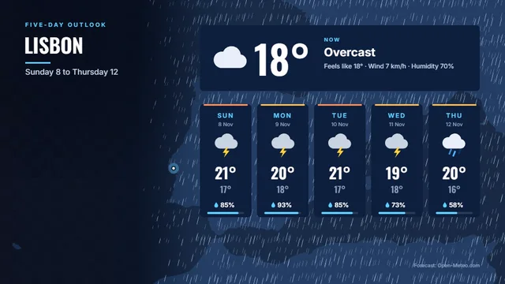
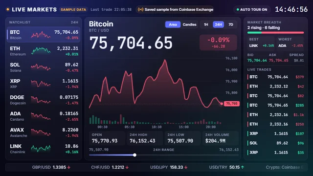
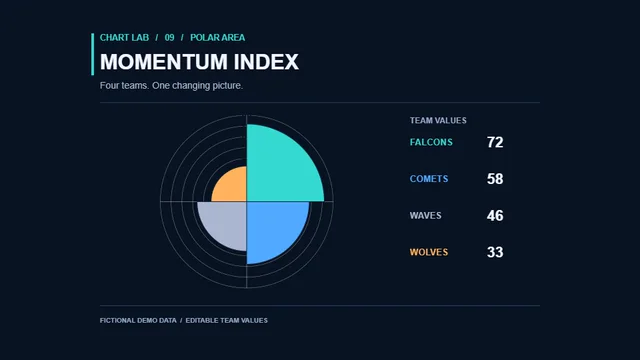
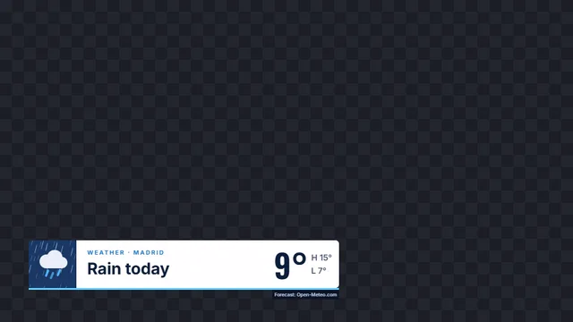
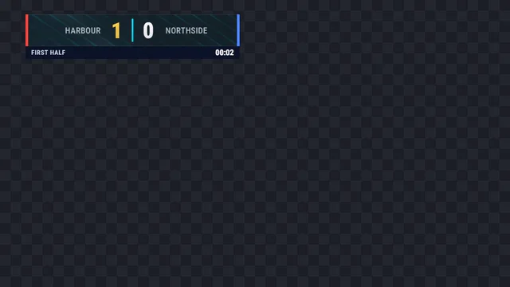
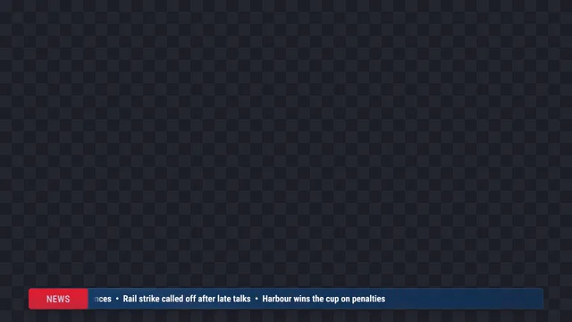
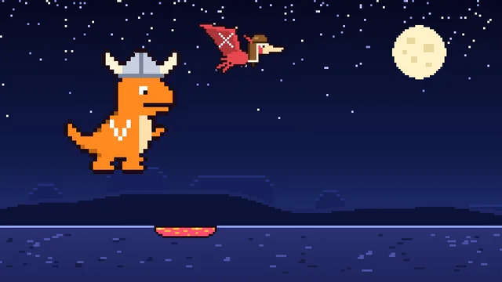

# OGraf Studio examples

Editable example projects for [OGraf Studio](https://github.com/zerodensity/ograf-studio), the
open-source editor for EBU OGraf broadcast graphics.

Studio's project explorer lists these examples. It reads `catalog.json` from this repository's
`main` branch and downloads an example when you open it.

## License and credits

Zero Density's original example work is available under the [GNU Affero General Public License
version 3 only](LICENSE) (`AGPL-3.0-only`). Project Explorer shows the author in the details
pane and the license and attribution in **License & Credits**. Third-party fonts, plugins, maps, and data
retain their own terms, which are identified in the credits and embedded notices where applicable.
Live Markets includes live and saved Coinbase Exchange data subject to its
[Market Data Terms](https://www.coinbase.com/legal/market_data).

## Examples

| Preview | Example | Level |
| --- | --- | --- |
| [](weather/) | **[Europe weather](https://ografstudio.org/examples/weather)**<br>A five-step weather show for a presenter on a live forecast, with touch buttons and see-through rain and snow. | Advanced |
| [](live-markets/) | **[Live markets](https://ografstudio.org/examples/live-markets)**<br>A markets dashboard playing real prices from a public feed, with a chart you can click and read. | Advanced |
| [](rankings/) | **[Rankings](https://ografstudio.org/examples/rankings)**<br>A jury vote for a TV show: juries give points, and the board scores and reranks itself. | Advanced |
| [](charts/) | **[Chart set](https://ografstudio.org/examples/charts)**<br>Nine chart templates sharing four team values, with bars that grow in order and circular charts that sweep from 12 o'clock. | Intermediate |
| [](weather-strap/) | **[Weather strap](https://ografstudio.org/examples/weather-strap)**<br>A weather strap for news bulletins on a live forecast. Rain or snow falls inside its icon box. | Intermediate |
| [](bug/) | **[Bug / DOG](https://ografstudio.org/examples/bug)**<br>A channel identifier with a channel list and a pulsing live indicator. | Basic |
| [](clock/) | **[Clock](https://ografstudio.org/examples/clock)**<br>A live clock an operator or feed can switch between UTC and any time zone, on air. | Basic |
| [](countdown/) | **[Countdown](https://ografstudio.org/examples/countdown)**<br>Start, Pause, Reset and Restart buttons, overtime, and an alarm the graphic fires itself. | Intermediate |
| [](lower-third/) | **[Lower third](https://ografstudio.org/examples/lower-third)**<br>A name strap with one Style field that restyles it for news, breaking or sport. | Basic |
| [](scoreboard/) | **[Scoreboard](https://ografstudio.org/examples/scoreboard)**<br>Goal buttons, a match clock and a leader highlight that all run inside the graphic. | Intermediate |
| [](ticker/) | **[Ticker](https://ografstudio.org/examples/ticker)**<br>A native crawl with speed, direction, right-to-left text and update timing on the form. | Basic |
| [](lottie-pulse/) | **[Lottie pulse](https://ografstudio.org/examples/lottie-pulse)**<br>A small looping Lottie animation for checking your playout environment. | Basic |
| [](shader-background/) | **[Shader background](https://ografstudio.org/examples/shader-background)**<br>Animated GLSL light streaks with speed, tint and glow controls for the operator. | Intermediate |
| [](dino-run/) | **[Dino Run](https://ografstudio.org/examples/dino-run)**<br>A 15-second pixel-art cartoon with sound: a dinosaur runs, jumps, eats and grows, until the camera pulls back on a surprise. | Advanced |

Each folder also holds `preview.gif`, a short loop of the graphic playing.

## Open an example

- In OGraf Studio, choose it in the window that starts a new project.
- Or download the `.ogs` file from its folder and open it with **File → Open**.

## Add or change an example

1. Create a folder named by the example's ID: lowercase words joined by hyphens.
2. Put exactly one `.ogs` document in it.
3. Add `example.json` beside it:

   ```json
   {
     "title": "Europe weather",
     "summary": "A five-step weather show for a presenter on a live forecast.",
     "category": "Weather",
     "level": "Advanced",
     "tags": ["Live data", "Steps", "Shader"],
     "author": "Zero Density",
     "license": {
       "name": "AGPL-3.0-only",
       "url": "https://www.gnu.org/licenses/agpl-3.0.html",
       "attribution": "Original example work by Zero Density."
     },
     "page": "https://ografstudio.org/examples/weather"
   }
   ```

4. Run OGraf Studio's catalog script on this folder. It ships with Studio's project explorer:

   ```bash
   npx tsx scripts/buildExampleCatalog.ts <path-to-this-repository>
   ```

5. Review the changes, then commit the source metadata and generated catalog and media.

The script updates `catalog.json` and renders stale previews with headless Chrome. It writes
`thumbnail.webp`, `preview.mp4`, `preview.gif` and `.preview.json` when preview files are missing
or their render inputs have changed. An order or metadata edit reuses current preview files.

Optional keys in `example.json`:

| Key | Meaning |
| --- | --- |
| `license` | The example work's license name, optional HTTPS link, and optional attribution. |
| `credits` | Separate notices and attribution for third-party material. |
| `unlisted` | `true` keeps the example out of Studio's explorer. Its files stay visible here. |
| `released`, `updated` | Dates as `YYYY-MM-DD`. They default to the document's first and last commit. |
| `preview` | The actions the preview plays, for a graphic that only moves on an action. |

## Publish the shared order

Place example IDs in the desired order in `featured.json`, then regenerate `catalog.json` using
the command above. Publish both files to `main` in this repository. Studio picks up the order when
it refreshes the catalog. Its default **Featured** sort shows the listed IDs first in that order
and appends the remaining examples by latest update. List every example ID to control the entire
order. An example is marked **New** for 30 days after its release date.

Studio uses `released` for the **New** mark and nothing else. The 13 examples the catalog started
with carry `2026-10-01`, a date set by convention and not the day they first appeared, so that only
later additions get the mark. To list an example without the mark, give it a release date more than
30 days in the past.
